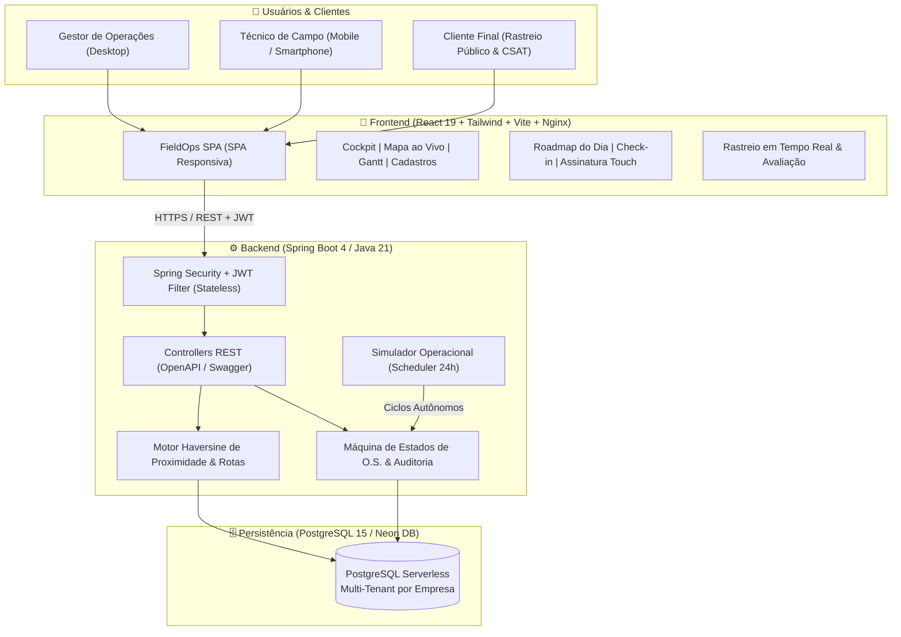

# FieldOps — Plataforma SaaS de Gestão e Despacho de Serviços em Campo

[](https://fieldopss.up.railway.app/)
[](https://apifieldopss.up.railway.app/api/status)
[](https://apifieldopss.up.railway.app/swagger-ui/index.html)
[](#-stack-tecnol%C3%B3gica)
[](LICENSE)

> **Projeto de Conclusão de Curso (Dev. Full Stack Jr. (+praTi & Codifica))**  
> Plataforma SaaS B2B para orquestração, geolocalização e automação inteligente de equipes técnicas em campo (*Field Service Management*).

---

## 🔗 Links Oficiais para Avaliação

Os recursos desenvolvidos ao longo do projeto estão publicados e operacionais nos seguintes endereços:

| Recurso | Descrição | Link de Acesso |
| :--- | :--- | :--- |
| **Aplicação Web (Frontend)** | Interface web completa responsiva para Gestores e Técnicos | [https://fieldopss.up.railway.app/](https://fieldopss.up.railway.app/) |
| **API RESTful (Backend)** | Servidor de aplicação em produção no Railway | [https://apifieldopss.up.railway.app/api/](https://apifieldopss.up.railway.app/api/) |
| **Documentação Swagger (OpenAPI)** | Especificação interativa de endpoints com autenticação JWT Bearer | [https://apifieldopss.up.railway.app/swagger-ui/index.html](https://apifieldopss.up.railway.app/swagger-ui/index.html) |
| **Healthcheck da API** | Verificação de integridade e conectividade com banco de dados | [https://apifieldopss.up.railway.app/api/status](https://apifieldopss.up.railway.app/api/status) |
| **Repositório Backend (GitHub)** | Código-fonte Java 21, Spring Boot, JPA, Security e Scheduler | [https://github.com/SaaS-FullStack-2026/saas-backend](https://github.com/SaaS-FullStack-2026/saas-backend) |
| **Repositório Frontend (GitHub)** | Código-fonte React 19, Tailwind CSS, Leaflet e Lucide Icons | [https://github.com/SaaS-FullStack-2026/saas-frontend](https://github.com/SaaS-FullStack-2026/saas-frontend) |

---

## 🔑 Credenciais de Teste

O sistema já é inicializado com dados de demonstração (seed) e auto-provisionamento de São Paulo. A banca pode utilizar os seguintes acessos imediatos:

| Perfil de Teste | E-mail de Acesso | Senha Padrão | Experiência de Uso Recomendada |
| :--- | :--- | :--- | :--- |
| **Gestor Operacional (Admin)** | `gestor@fieldops.com` | `123456` | Acesso ao Cockpit de Comando (`/dashboard`), Mapa em Tempo Real (`/mapa`), Linha do Tempo Gantt (`/linha-do-tempo`), Central de Cadastros (`/cadastros`) e Modo Simulação. |
| **Técnico de Campo (Mobile)** | `tecnico@fieldops.com` | `123456` | Redirecionamento para a visão móvel (`/mobile`): roadmap encadeado de entregas do dia, check-in, laudo técnico e assinatura digital na tela. |
| **Técnico Regional (SP)** | `tecnico.lucas@fieldops.com` | `123456` | Técnico alocado para a região Central/Paulista. |
| **Cliente Final (Sem Login)** | Rota Pública de Rastreio | Pública | Acompanhamento do técnico em trânsito com mapa e radar, status em tempo real e avaliação de satisfação CSAT de 1 a 5 estrelas. |

> [!TIP]
> **Atalho de Login Rápido:** Na tela inicial de login (`https://fieldopss.up.railway.app/login`), existem botões de 1 clique (**"Entrar como Gestor"** e **"Entrar como Técnico"**) para agilizar a navegação.

---

## 📌 Visão Geral do Produto

O **FieldOps** resolve o gargalo de comunicação entre equipes de suporte/despacho e os profissionais em campo (técnicos de refrigeração, eletricistas industriais, instaladores de telecomunicações e equipes de manutenção predial).

### Principais Diferenciais:
1. **Despacho Inteligente por Proximidade:** Cálculo automático da distância em linha reta e tempo estimado de trânsito urbano via fórmula Haversine, sugerindo sempre o técnico mais adequado e alertando sobre gargalos.
2. **Máquina de Estados Finita e Auditoria:** Ciclo de vida estrito (`ABERTA` ➔ `ATRIBUIDA` ➔ `EM_DESLOCAMENTO` ➔ `EM_ATENDIMENTO` ➔ `CONCLUIDA`), garantindo conformidade contratual (SLA) com registro imutável de quem alterou, quando e por qual motivo.
3. **Cockpit e Mapa em Tempo Real:** Visualização geográfica ao vivo das rotas de cada colaborador em São Paulo com marcadores personalizados, sede de despacho e filtros reativos de data.
4. **Linha do Tempo Gantt Operacional:** Cronograma horizontal interativo por colaborador, com detecção visual de atrasos viários e rebalanceamento inteligente de chamados.
5. **Modo Técnico Mobile:** Interface pensada para smartphone com checklist de serviço, captura de coordenadas GPS, preenchimento de laudo e assinatura touch na tela do cliente.
6. **Rastreamento Público Estilo Uber/iFood:** Link direto enviado ao cliente para acompanhar o deslocamento do colaborador e avaliar a qualidade do serviço (CSAT).
7. **Modo Simulação Operacional (Digital Twin 24h):** Motor autônomo com Bot Despachante e Bots Técnicos que criam ordens, simulam imprevistos de tráfego, realizam check-in/out e preenchem avaliações continuamente com auto-provisionamento de dados.

---

## 🏗️ Arquitetura de Software



---

## 💻 Stack Tecnológica

| Camada | Tecnologias Utilizadas |
| :--- | :--- |
| **Frontend** | React 19, Vite, Tailwind CSS, Lucide Icons, Leaflet (React-Leaflet), Canvas Signature Pad, Axios |
| **Backend** | Java 21 (Eclipse Temurin), Spring Boot 4.1.x, Spring Web, Spring Security, Spring Data JPA, Hibernate, Lombok |
| **Segurança** | Autenticação Stateless via JSON Web Tokens (JWT) com assinatura HMAC-SHA256 e senhas criptografadas em BCrypt |
| **Banco de Dados** | PostgreSQL 15, Neon Serverless Database, Pool de Conexões HikariCP, Migrações Flyway |
| **Documentação** | OpenAPI 3.0 / Swagger UI com esquema de autorização Bearer JWT |
| **Containers & Deploy** | Docker, Dockerfile multi-stage, Docker Compose, Nginx Alpine, Railway Cloud Platform |

---

## 🐳 Execução Rápida via Docker Compose (1 Comando)

Para rodar todo o ecossistema localmente (**PostgreSQL + Backend + Frontend**) sem precisar instalar Java ou Node.js na máquina hospedeira:

### Pré-requisitos:
* [Docker Desktop](https://www.docker.com/) ou Docker Engine instalado e rodando.

### Inicialização:
```bash
# 1. Clone o repositório ou navegue até a raiz do projeto
cd javasaas

# 2. Suba todos os containers com build automático
docker compose up --build
```

### URLs de Acesso Local:
* **Frontend:** [http://localhost:3000](http://localhost:3000) (ou [http://localhost](http://localhost))
* **Backend API:** [http://localhost:8080/api/status](http://localhost:8080/api/status)
* **Swagger UI:** [http://localhost:8080/swagger-ui/index.html](http://localhost:8080/swagger-ui/index.html)
* **PostgreSQL:** `localhost:5432` (Usuário: `postgres`, Senha: `postgres`, Banco: `fieldops_db`)

---

## 🛠️ Execução em Modo de Desenvolvimento (Sem Docker)

Caso queira executar os projetos separadamente em sua IDE favorita:

### 1. Backend (Spring Boot):
```bash
cd saas-backend

# Executar testes unitários
./mvnw test -Dtest=OrdemServicoServiceTest

# Iniciar a aplicação
./mvnw spring-boot:run
```
*A API iniciará na porta `8080` (ou na definida em `application.properties`).*

### 2. Frontend (React + Vite):
```bash
cd saas-frontend

# Instalar dependências
npm install

# Iniciar servidor de desenvolvimento
npm run dev
```
*O frontend iniciará em `http://localhost:5173`.*

---

## 📋 Módulos e Funcionalidades Desenvolvidas

```
📦 FieldOps
├── 📊 Visão Geral
│   └── Cockpit de Comando (KPIs de SLA, CSAT, Pontualidade BI, Alertas Críticos e Acesso Rápido)
├── 🗺️ Operações & Despacho
│   ├── Ordens de Serviço (Filtros avançados, busca textual, detalhes técnicos, laudo e assinatura)
│   ├── Linha do Tempo Gantt (Cronograma diário por colaborador, detecção de atraso viário e rebalanceamento)
│   └── Mapa em Tempo Real (Leaflet com satélite/rua, sede TechOps, colaboradores e rotas do dia)
├── 🏢 Gestão & Cadastros
│   ├── Central de Cadastros (Colaboradores com perfil e status, Clientes com GPS em SP, Equipamentos com QR Code)
│   └── Status da API (Diagnóstico de latência e conectividade)
├── 📱 Visão de Campo
│   └── Modo Técnico Mobile (Roadmap do dia, navegação GPS, check-in, laudo e assinatura touch na tela)
├── 🌐 Experiência do Cliente
│   └── Rastreamento Público de OS (Link público sem login com status, mapa e avaliação CSAT)
└── 🤖 Autonomia & Inteligência
    └── Modo Simulação Digital Twin (Bot Despachante + Bots Técnicos rodando 24h com Auto-Provisioning)
```

---

## 👥 Equipe do Projeto de Conclusão de Curso (2026)

* **Líder do Grupo & Desenvolvimento Full Stack:**
* Lucas dias (`lukadsant.dev`)
* ingrid Vitória(`@vivif001`)
* Matheus Guilherme(`@devdiresto`)
* Osmar(`@osmardi2711@gmail.com`)
* Lucas Siqueira(`dev.lucassiqueira@gmail.com`)
* Leandro(`leandrofr2014@gmail.com`)
* Felipe(`felipehehn@hotmail.com`)
* Lucas (`lucasdevcontato64@gmail.com`)

* **Repositório da Organização:** [https://github.com/SaaS-FullStack-2026](https://github.com/SaaS-FullStack-2026)
